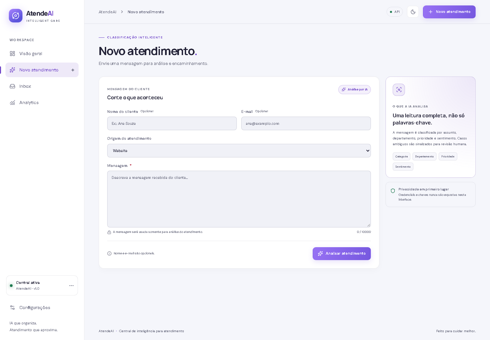
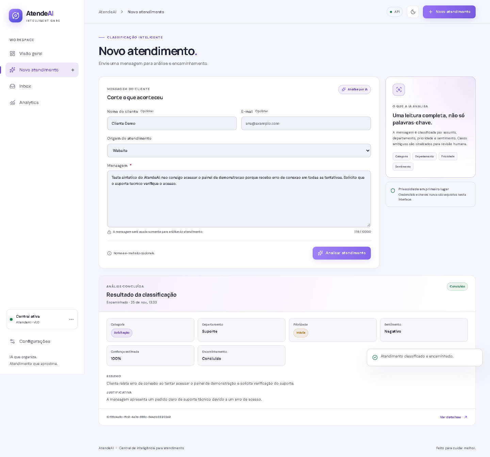
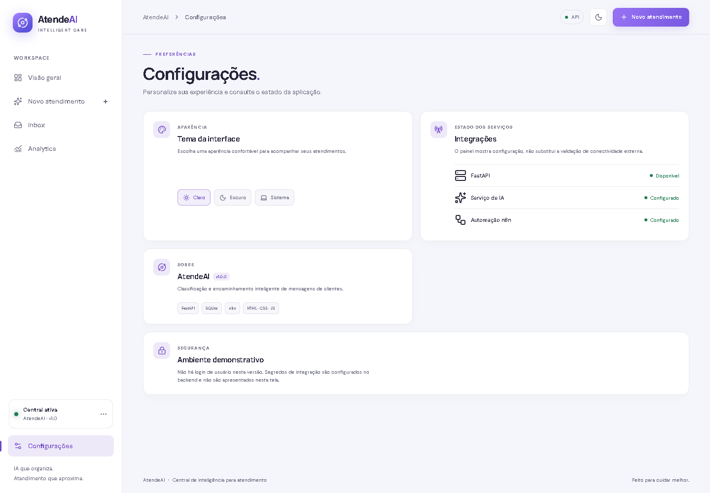
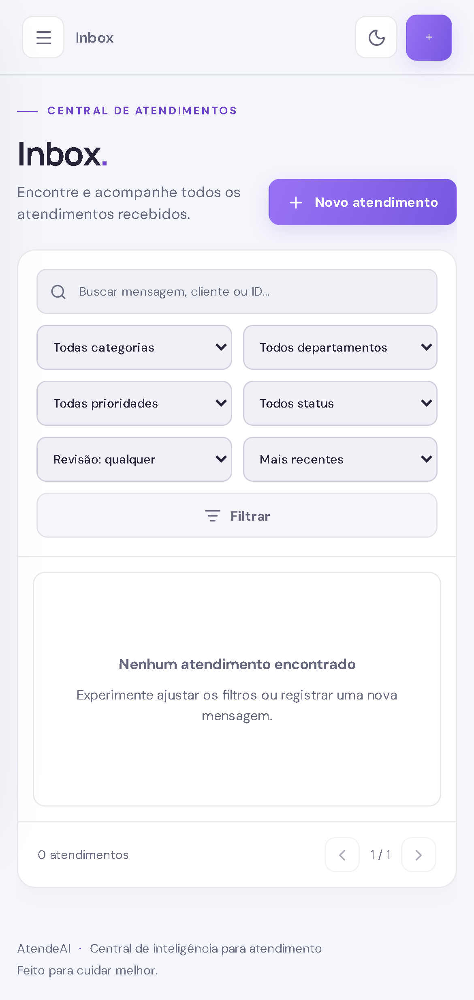
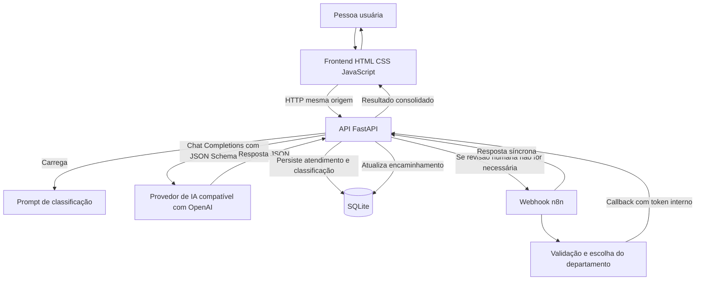
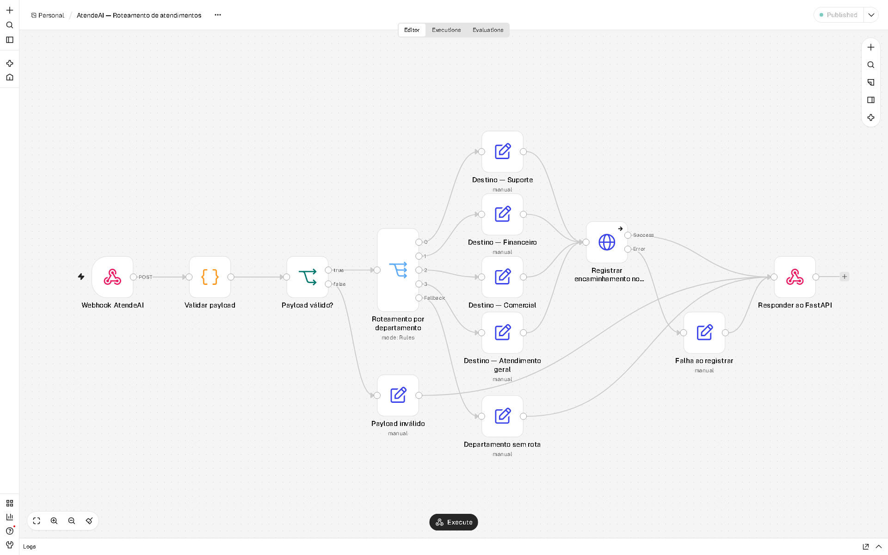
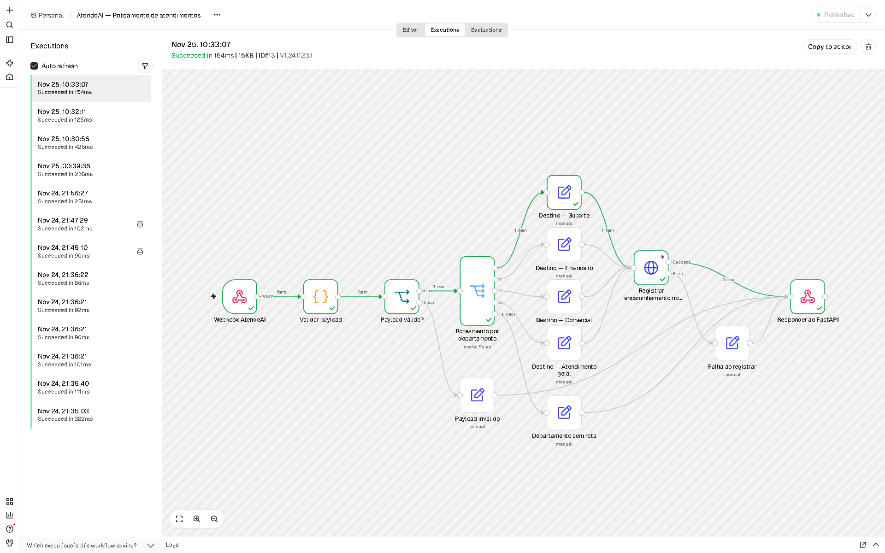

# AtendeAI

**Triagem inteligente de atendimentos, com classificação estruturada e encaminhamento demonstrável.** O AtendeAI combina uma interface web, uma API FastAPI, um provedor de IA compatível com OpenAI Chat Completions, SQLite e uma automação n8n.

[](LICENSE)

O projeto foi desenvolvido como solução demonstrativa para o desafio técnico KODIE de integração entre inteligência artificial, API e automação. A classificação é feita no backend; o n8n registra o departamento de destino no próprio AtendeAI. Não há integração com uma plataforma externa de atendimento.

## Navegação

- [Problema e proposta](#problema-e-proposta)
- [Funcionalidades](#funcionalidades)
- [Demonstração visual](#demonstração-visual)
- [Arquitetura e fluxo](#arquitetura-e-fluxo)
- [Tecnologias](#tecnologias)
- [Como executar](#como-executar)
- [Workflow n8n](#workflow-n8n)
- [Configuração e segurança](#configuração-e-segurança)
- [Estrutura do projeto](#estrutura-do-projeto)
- [Testes e limitações](#testes-e-limitações)
- [Documentação](#documentação)

## Problema e proposta

Pequenas equipes podem receber mensagens de clientes com dúvidas, reclamações, solicitações e elogios. A triagem manual exige leitura, identificação de prioridade e encaminhamento ao setor adequado; esse trabalho pode consumir tempo e atrasar o atendimento.

O AtendeAI demonstra como organizar essa etapa: a pessoa registra uma mensagem, a API solicita uma classificação estruturada à IA, valida e persiste o resultado e, quando não é necessária revisão humana, aciona o n8n para registrar o departamento de destino. A interface permite acompanhar indicadores e consultar atendimentos.

A classificação inclui categoria, departamento, prioridade, sentimento, resumo, confiança estimada, justificativa e indicação de revisão humana. A confiança é uma estimativa do modelo, não uma garantia estatística. Casos marcados para revisão — ou abaixo do limite configurado — não são encaminhados automaticamente.

## Funcionalidades

- Criar atendimentos com mensagem e dados de cliente opcionais.
- Classificar mensagens em categorias, departamentos, prioridades e sentimentos definidos.
- Consultar resumo, justificativa, confiança estimada e necessidade de revisão humana.
- Persistir atendimentos, classificações e estado de encaminhamento em SQLite.
- Buscar, filtrar, paginar e consultar detalhes na Inbox.
- Visualizar indicadores, distribuições e volume ao longo do tempo.
- Demonstrar o roteamento para quatro departamentos pelo workflow n8n.
- Retentar encaminhamentos elegíveis sem apagar a classificação já concluída.
- Usar a interface em temas claro e escuro, com layout responsivo.

## Demonstração visual

As imagens abaixo são capturas reais do AtendeAI. As telas de estado vazio usam a API em execução; resultado e detalhes foram registrados com mensagem sintética, sem dados pessoais.

<table>
  <tr>
    <td width="50%"><p><strong>Visão geral.</strong> Indicadores e gráficos baseados nos dados persistidos.</p></td>
    <td width="50%"><p><strong>Novo atendimento.</strong> Entrada de mensagem e dados opcionais do cliente.</p></td>
  </tr>
  <tr>
    <td width="50%"><p><strong>Resultado da IA.</strong> Classificação sintética real, encaminhada pelo n8n.</p></td>
    <td width="50%"><p><strong>Inbox.</strong> Busca, filtros e paginação dos atendimentos.</p></td>
  </tr>
  <tr>
    <td width="50%"><p><strong>Detalhes.</strong> Informações do atendimento confirmadas pela API.</p></td>
    <td width="50%"><p><strong>Analytics.</strong> Distribuições e evolução dos registros.</p></td>
  </tr>
  <tr>
    <td width="50%"><p><strong>Tema escuro.</strong> Preferências e estado configurado dos serviços.</p></td>
    <td width="50%"><p><strong>Tema claro.</strong> Alternância de aparência da interface.</p></td>
  </tr>
  <tr>
    <td width="50%"><p><strong>Dashboard móvel.</strong> Layout adaptado a telas pequenas.</p></td>
    <td width="50%"><p><strong>Inbox móvel.</strong> Navegação e consulta responsivas.</p></td>
  </tr>
</table>

## Arquitetura e fluxo



1. A interface envia a mensagem à API; o navegador não chama diretamente IA, banco ou n8n.
2. A API valida e persiste o atendimento e envia a mensagem, tratada como dado não confiável, ao serviço de IA junto ao prompt.
3. A resposta estruturada é validada por JSON Schema estrito e por Pydantic. O backend aplica o limite de confiança e a regra de revisão humana.
4. Se houver revisão, o encaminhamento automático fica bloqueado. Caso contrário, a API chama o webhook n8n server-to-server.
5. O n8n valida o payload, escolhe um de quatro departamentos e chama o callback autenticado da API para registrar o resultado.
6. A API atualiza o estado persistido e devolve o resultado ao frontend.

Se o n8n não estiver configurado ou falhar, a classificação permanece armazenada e o estado do encaminhamento pode ser consultado. O n8n demonstra o registro do destino no AtendeAI; não cria chamados em um serviço externo.

## Tecnologias

| Categoria | Tecnologias | Uso no projeto |
|---|---|---|
| Frontend | HTML, CSS, JavaScript ES6+ | Interface estática servida pela própria API. |
| Recursos visuais | Chart.js, Lucide, Google Fonts (DM Sans e Manrope) | Gráficos, ícones e fontes carregados no frontend por CDN. |
| Backend | Python 3.11+, FastAPI, Pydantic, SQLAlchemy, HTTPX | API, validação, persistência e chamadas HTTP assíncronas. |
| Inteligência artificial | API compatível com OpenAI Chat Completions | Classificação estruturada com `response_format: json_schema`. O exemplo de ambiente usa Gemini via endpoint compatível. |
| Automação | n8n | Validação do payload, roteamento por departamento e callback à API. |
| Armazenamento | SQLite | Atendimentos, classificações e encaminhamentos locais. |
| Infraestrutura | Docker, Docker Compose | Execução da API e do n8n com persistência local. |
| Testes | Pytest, Playwright, axe-core | Testes de backend e de navegador, incluindo verificações de acessibilidade. |

O cliente de IA usa o protocolo compatível com OpenAI e exige suporte do provedor a JSON Schema estrito. `AI_PROVIDER` não corresponde a uma coleção de adaptadores independentes por fornecedor.

## Decisões de projeto

- **Backend como fonte da verdade:** valida entradas e saídas, aplica regras de revisão, persiste os dados e expõe uma API única para o frontend.
- **Resposta de IA estruturada:** JSON Schema estrito reduz variações no formato; Pydantic faz a validação local antes de persistir.
- **IA e automação separadas:** a classificação acontece no backend; o n8n decide o ramo e registra o encaminhamento sem incorporar regras centrais de classificação.
- **Falha do encaminhamento não apaga a classificação:** os estados de classificação e de roteamento são mantidos separadamente para permitir consulta e retentativa elegível.
- **Stack leve para demonstração:** frontend sem framework pesado, SQLite e Compose simplificam a execução local do conjunto.

## Como executar

### Docker Compose — caminho recomendado

Pré-requisitos: Docker Desktop ou Docker Engine com Docker Compose.

No PowerShell, na raiz do projeto:

```powershell
if (-not (Test-Path .env)) { Copy-Item .env.example .env }
```

Edite `.env` e configure `AI_API_KEY`, `N8N_API_TOKEN` e `INTERNAL_API_TOKEN`. Use tokens longos e diferentes. Se trocar de provedor, ajuste `AI_BASE_URL` e `AI_MODEL`. Em seguida:

```powershell
docker compose up --build
```

Acesse:

- AtendeAI: `http://localhost:8000`
- n8n: `http://localhost:5678`
- Swagger/OpenAPI da API: `http://localhost:8000/docs`

A stack contém a API (que também serve o frontend) e o n8n. O banco SQLite é persistido em `./data`; os dados do n8n ficam no volume `n8n_data`. O workflow precisa ser importado, receber as credenciais e ser publicado no n8n. Veja [Workflow n8n](#workflow-n8n) e o [guia completo](docs/WORKFLOW_N8N.md).

### Execução local da API

Requer Python 3.11 ou superior. No PowerShell:

```powershell
py -3.11 -m venv .venv
.\.venv\Scripts\Activate.ps1
python -m pip install -r requirements.txt
if (-not (Test-Path .env)) { Copy-Item .env.example .env }
```

Configure a IA em `.env` e inicie a API, que serve também o frontend:

```powershell
uvicorn app.main:app --reload
```

Sem um n8n acessível e `N8N_WEBHOOK_URL` configurado, a API pode classificar e persistir atendimentos, mas o encaminhamento permanecerá pendente. Para executar todos os componentes juntos, prefira Compose.

## Workflow n8n

O n8n recebe a classificação pronta da API; **a IA não é executada dentro do workflow**. O fluxo valida o payload, direciona para `support`, `financial`, `commercial` ou `customer_service`, registra o destino no callback protegido da API e responde ao webhook.



*Visão geral do workflow publicado na instância usada na demonstração. O arquivo exportado no repositório está inativo por padrão e exige configuração de credenciais antes da publicação.*



*Execução demonstrativa com mensagem sintética e callback concluído.*

Capturas reais das configurações dos nodes de webhook, validação, decisão, roteamento, destinos, tratamento de erros, callback e resposta estão em [`docs/screenshots/`](docs/screenshots/). A documentação detalhada está em [`docs/WORKFLOW_N8N.md`](docs/WORKFLOW_N8N.md).

O [índice visual](docs/screenshots/README.md) relaciona as capturas reais e suas finalidades.

## Configuração e segurança

- `.env.example` contém nomes e valores de exemplo; as credenciais ficam vazias. Copie-o para `.env` e não versione o arquivo local.
- `.env` e o banco local são ignorados pelo Git. Tokens também devem ser configurados como credenciais no n8n; nunca os inclua no workflow exportado, README ou screenshots.
- O callback interno exige `INTERNAL_API_TOKEN`; o webhook n8n exige `N8N_API_TOKEN`.
- O provedor de IA recebe o texto submetido para classificação. Revise as condições de privacidade do provedor e use dados sintéticos ou autorizados.
- Esta versão não tem autenticação de usuário final e não deve ser exposta publicamente sem controles de acesso e hardening adicionais.

## Estrutura do projeto

```text
app/                 API, schemas, serviços, modelos e persistência
frontend/            Interface HTML, CSS e JavaScript
prompts/             Prompt de classificação e casos de avaliação
workflows/           Exportação JSON do workflow n8n
tests/               Testes Python e testes de navegador
scripts/             Sondas para IA e webhook n8n
docs/                Arquitetura, API, desenvolvimento e workflow
  screenshots/       Capturas reais do frontend e do n8n
data/                Banco SQLite local (não versionado)
Dockerfile           Imagem da API
docker-compose.yml   API e n8n com persistência
requirements.txt     Dependências Python
```

## Testes e limitações

Os testes de backend usam SQLite temporário e mocks; a suíte Playwright usa respostas da API simuladas. Portanto, testes automatizados não substituem uma validação com credenciais reais e os serviços externos disponíveis.

- Backend: `python -m pytest -q`
- Playwright, sondas de integração e detalhes de execução: [`docs/DEVELOPMENT.md`](docs/DEVELOPMENT.md)

### Estado atual

- **Implementado:** interface, API, classificação estruturada, persistência SQLite, Inbox, analytics, temas, roteamento demonstrativo para quatro departamentos e callback autenticado do n8n.
- **Dependente de configuração externa:** classificação real requer credenciais e um provedor compatível; o encaminhamento n8n requer importar o workflow, configurar credenciais e publicá-lo.
- **Não implementado nesta versão:** login/gestão de usuários e integração com CRM ou plataforma externa de atendimento. SQLite e Compose estão preparados para demonstração local, não para uma implantação multiusuário de produção.
- **Evoluções possíveis, não disponíveis hoje:** autenticação de usuários, processamento assíncrono, histórico detalhado de cada tentativa e integrações externas autorizadas.
- **Documentação visual:** inclui capturas reais das telas do frontend, da execução do workflow n8n e das configurações dos nodes e caminhos de erro.

## Contexto do desafio

O AtendeAI foi desenvolvido no contexto do desafio técnico KODIE, com foco em demonstrar a integração entre IA, uma API Python/FastAPI, validação de respostas estruturadas, persistência e automação com n8n. O projeto reúne esses componentes em um fluxo utilizável de ponta a ponta sem afirmar integrações externas que não existem.

## Documentação

- [Arquitetura](docs/architecture.md)
- [API e contratos](docs/API.md)
- [Workflow n8n e configuração](docs/WORKFLOW_N8N.md)
- [Desenvolvimento, testes e sondas](docs/DEVELOPMENT.md)
- [Índice das capturas reais](docs/screenshots/README.md)

---

Desenvolvido no contexto do desafio técnico KODIE, com foco na integração entre IA, API, persistência e automação.
