# Workflow n8n

O workflow demonstra o encaminhamento de atendimentos classificados. A classificação é realizada pela API antes de chamar o n8n; **não existe node de IA no workflow**. Os ramos representam o departamento de destino no próprio AtendeAI. Não há integração configurada com um CRM ou uma plataforma externa de atendimento.

## Visão geral

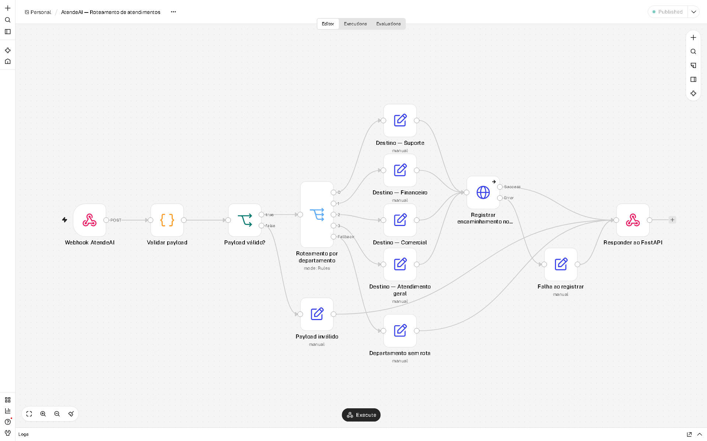

*Workflow publicado na instância n8n usada para a demonstração. O arquivo exportado no repositório está inativo por padrão.*

Sequência do workflow:

1. **Webhook AtendeAI** recebe o `POST` autenticado enviado pelo backend.
2. **Validar payload** verifica identificador, chave de idempotência, departamento permitido e ausência de revisão humana pendente.
3. **Payload válido?** separa payloads válidos dos inválidos.
4. **Roteamento por departamento** seleciona `support`, `financial`, `commercial` ou `customer_service`.
5. O node **Destino — ...** prepara os dados do ramo, incluindo departamento, status `completed` e ID da execução do n8n.
6. **Registrar encaminhamento no FastAPI** chama o callback interno autenticado.
7. **Responder ao FastAPI** devolve o resultado síncrono à API.

Payloads inválidos, departamentos sem ramo e falhas no callback seguem caminhos de erro e retornam informações estruturadas. O status `completed` significa que o departamento foi registrado no AtendeAI; não representa a entrega a um sistema externo.

## Nodes documentados visualmente

| Node | Captura | Responsabilidade |
|---|---|---|
| Webhook AtendeAI | [webhook-settings.png](screenshots/nodes/webhook-settings.png) | Recebe `POST` no caminho de produção `/webhook/atendeai/route`, com autenticação Header Auth. |
| Validar payload | [validation-settings.png](screenshots/nodes/validation-settings.png) | Confere campos obrigatórios, departamento permitido e flag de revisão. |
| Payload válido? | [payload-validity-settings.png](screenshots/nodes/payload-validity-settings.png) | Continua pelo ramo válido somente quando a validação retorna `true`. |
| Roteamento por departamento | [department-router-settings.png](screenshots/nodes/department-router-settings.png) | Seleciona um dos quatro ramos de atendimento. |
| Destino — Suporte | [destination-support-settings.png](screenshots/nodes/destination-support-settings.png) | Prepara os campos do ramo `support`. |
| Destino — Financeiro | [destination-financial-settings.png](screenshots/nodes/destination-financial-settings.png) | Prepara os campos do ramo `financial`. |
| Destino — Comercial | [destination-commercial-settings.png](screenshots/nodes/destination-commercial-settings.png) | Prepara os campos do ramo `commercial`. |
| Destino — Atendimento geral | [destination-customer-service-settings.png](screenshots/nodes/destination-customer-service-settings.png) | Prepara os campos do ramo `customer_service`. |
| Payload inválido | [invalid-payload-settings.png](screenshots/nodes/invalid-payload-settings.png) | Retorna falha e HTTP 422 para payload rejeitado. |
| Departamento sem rota | [unknown-department-settings.png](screenshots/nodes/unknown-department-settings.png) | Retorna falha e mensagem para departamento sem ramo. |
| Registrar encaminhamento no FastAPI | [fastapi-callback-settings.png](screenshots/nodes/fastapi-callback-settings.png) | Envia `department`, `status` e `execution_id` ao callback da API. |
| Falha ao registrar | [callback-error-settings.png](screenshots/nodes/callback-error-settings.png) | Prepara a resposta de falha do HTTP Request, com HTTP 502. |
| Responder ao FastAPI | [webhook-response-settings.png](screenshots/nodes/webhook-response-settings.png) | Devolve resposta estruturada e status HTTP ao chamador. |

As capturas foram feitas na interface real do n8n. Os valores de credenciais não são exibidos. A lista de arquivos e suas finalidades também está em [`screenshots/README.md`](screenshots/README.md).

### Configurações capturadas

#### Webhook AtendeAI

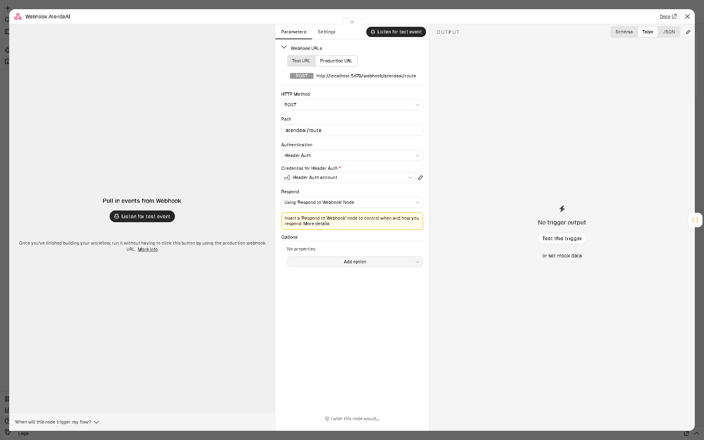

*Método, caminho de produção e seleção de autenticação do webhook.*

#### Validar payload

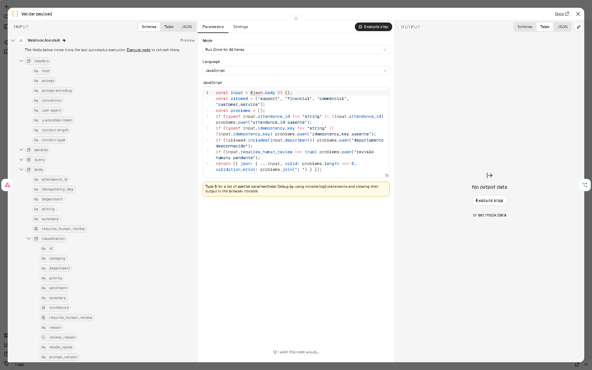

*Validação estrutural dos campos recebidos antes do roteamento.*

#### Payload válido?

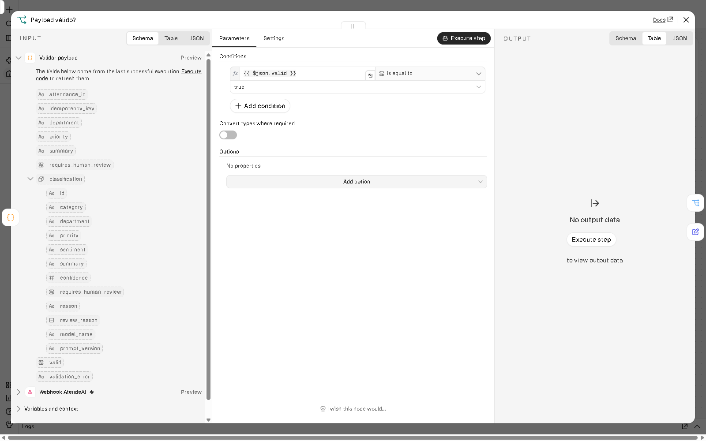

*A saída `true` prossegue ao roteamento; a saída `false` segue para o tratamento de payload inválido.*

#### Roteamento por departamento

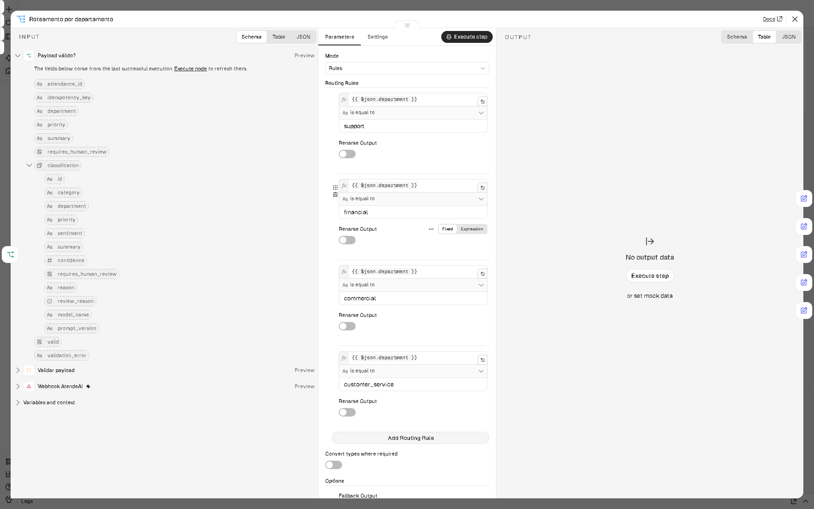

*Regras do Switch para os quatro destinos implementados.*

#### Preparar destinos

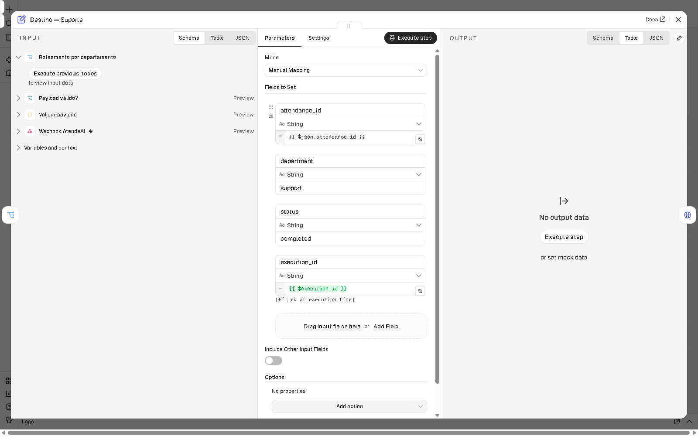

*O ramo `support` prepara o ID do atendimento, o departamento e o status `completed`. O ID da execução vem do contexto do n8n.*

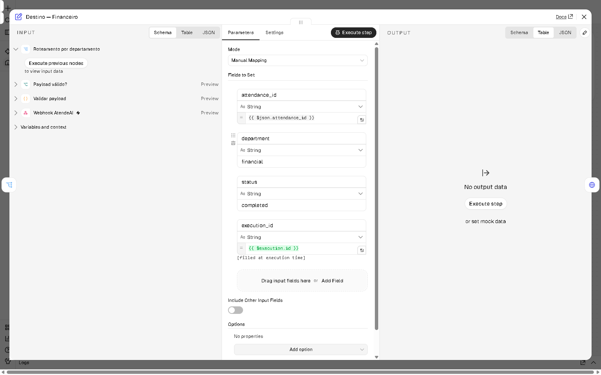

*O ramo `financial` usa a mesma estrutura e define o departamento financeiro.*


*O ramo `commercial` usa a mesma estrutura e define o departamento comercial.*

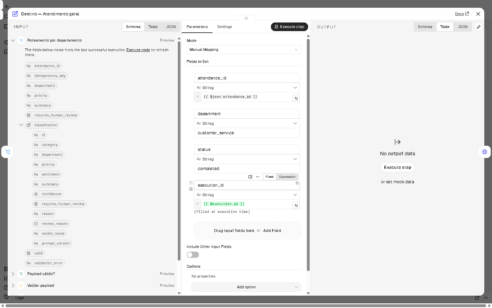

*O ramo `customer_service` usa a mesma estrutura e define o departamento de atendimento geral.*

#### Tratamento de erros

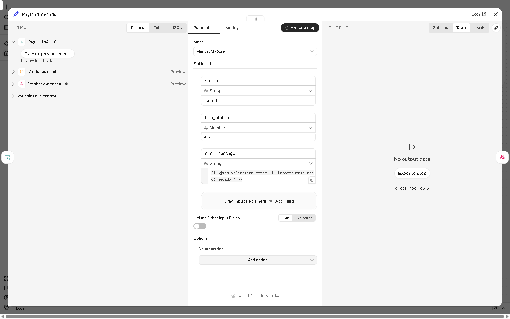

*O node encaminha uma mensagem de validação e código HTTP 422 ao Respond to Webhook.*

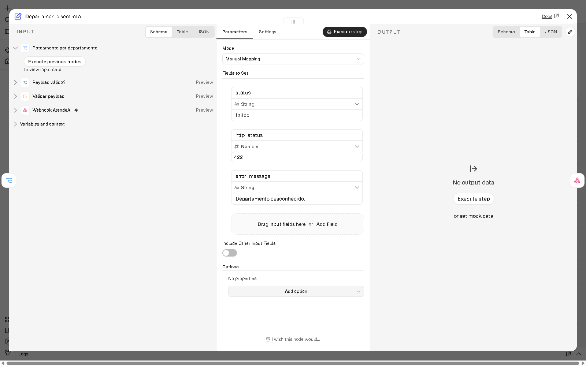

*Fallback do Switch: retorna falha e uma mensagem de departamento desconhecido.*

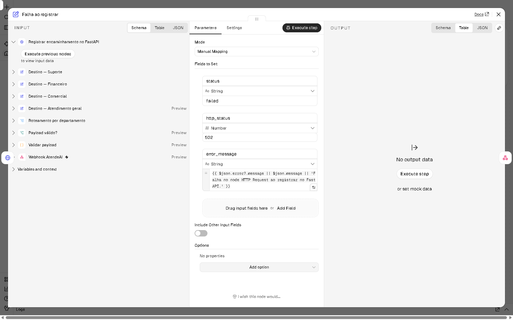

*O caminho de erro do HTTP Request prepara `failed`, HTTP 502 e a mensagem da falha.*

#### Registrar encaminhamento no FastAPI

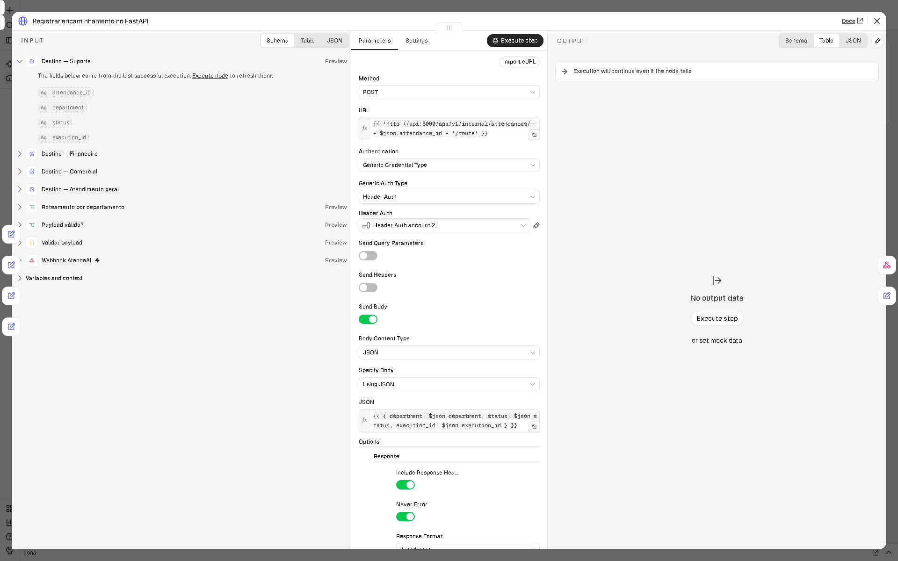

*Chamada POST ao endpoint interno, com URL dinâmica e credencial selecionada sem revelar seu valor.*

#### Responder ao FastAPI

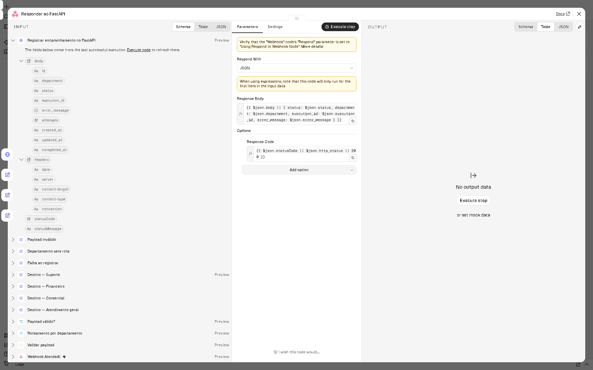

*Resposta estruturada ao backend, incluindo o status HTTP.*

## Resultado de uma execução

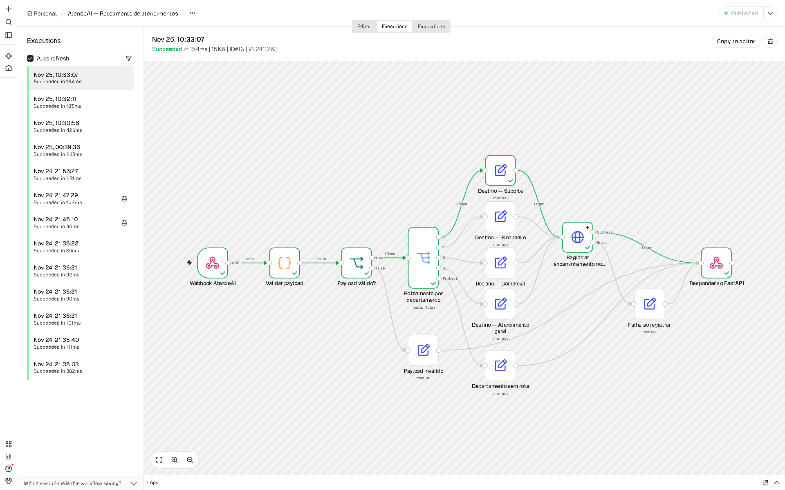

*Execução real de demonstração com mensagem sintética, ramo `support` e callback concluído.*

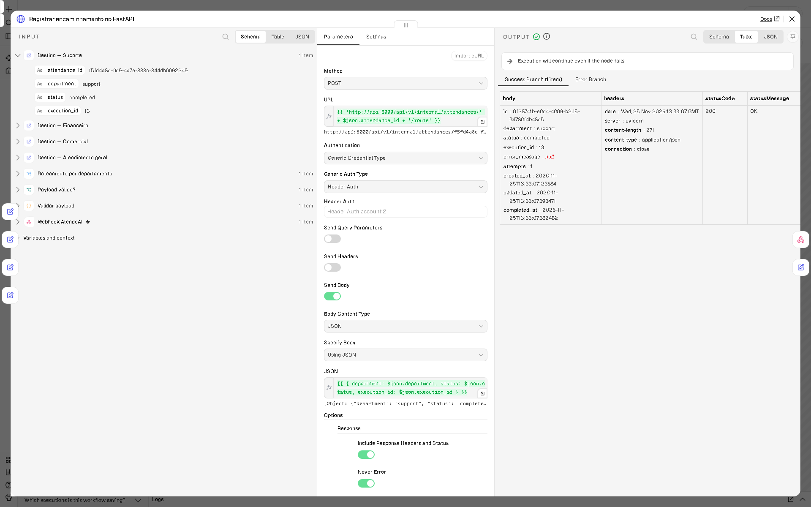

*Resposta do callback autenticado. Os dados exibidos são sintéticos.*

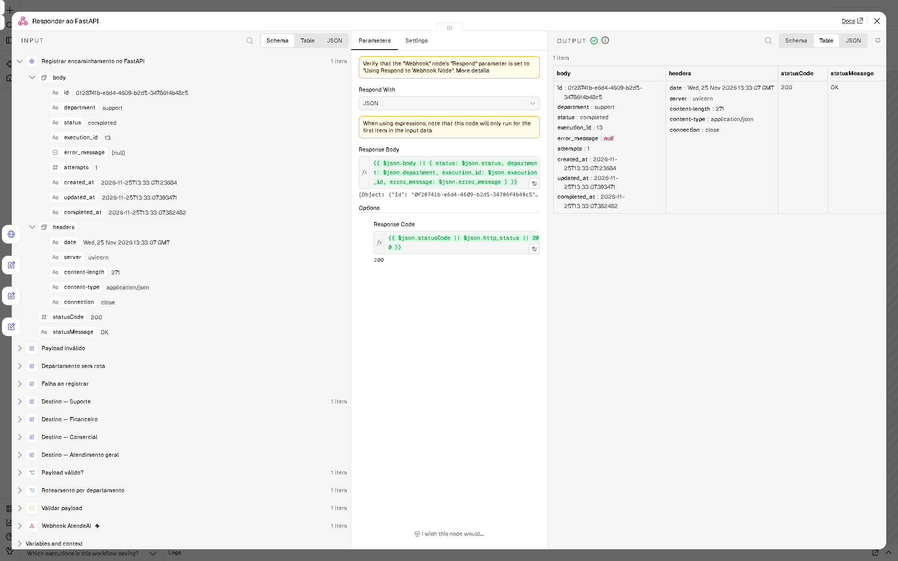

*Resposta final da mesma execução, encaminhada ao backend.*

## Importar e configurar

O serviço n8n do Compose usa a versão `2.48.7` e fica disponível por padrão em `http://localhost:5678`.

1. Inicie a stack conforme [`DEVELOPMENT.md`](DEVELOPMENT.md) e conclua a configuração inicial do n8n.
2. Importe `workflows/atendeai-workflow.json`.
3. Crie uma credencial **Header Auth** para o Webhook:
   - **Name:** `X-AtendeAI-Token`
   - **Value:** o valor de `N8N_API_TOKEN` configurado no ambiente da API.
4. Crie outra credencial **Header Auth** para o node **Registrar encaminhamento no FastAPI**:
   - **Name:** `Authorization`
   - **Value:** `Bearer <INTERNAL_API_TOKEN>`, usando o mesmo token configurado na API.
5. Selecione cada credencial no respectivo node. O nome exibido para a credencial é um rótulo; os campos **Name** e **Value** definem o cabeçalho HTTP enviado.
6. No node de callback, use modo **Expression** no campo URL. Para Compose, a expressão é:

   ```text
   {{ 'http://api:8000/api/v1/internal/attendances/' + $json.attendance_id + '/route' }}
   ```

   No JSON exportado, o valor deve ter um único `=` antes da expressão (`={{ ... }}`). No editor do n8n, cole a expressão sem o `=` manual. Entre containers, use `api:8000`, não `localhost`.
7. Publique o workflow no n8n. O JSON exportado tem `active: false` e não inclui valores de credenciais.

Para execução fora da rede do Compose, ajuste o endereço do callback para um host alcançável pelo n8n. Não exponha tokens nem inclua valores de credenciais no JSON exportado.

## Verificar a integração

Com a API, o n8n, as credenciais e o workflow publicados, a sonda abaixo verifica o webhook e alcança o callback protegido usando um UUID que não existe no banco:

```powershell
docker compose exec -T api python -m scripts.check_n8n_webhook
```

O `404` do callback para esse ID inexistente é esperado pela sonda: demonstra que as autenticações foram aceitas sem criar atendimento. Para confirmar encaminhamento funcional, envie uma mensagem sintética pela aplicação; isso também requer uma chamada ao provedor de IA configurado.

## Segurança e dados

- Gere tokens longos e exclusivos para `N8N_API_TOKEN` e `INTERNAL_API_TOKEN`.
- Mantenha os valores em `.env` e nas credenciais gerenciadas pelo n8n; não os publique em capturas.
- Use dados sintéticos ou autorizados para testes. A classificação envia o texto ao provedor externo configurado.
- A chamada ao n8n é feita pelo backend; o navegador não recebe esses tokens.
