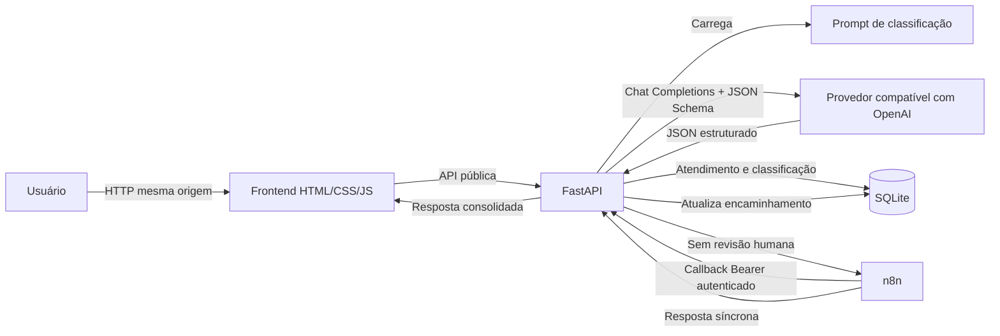

# Arquitetura do AtendeAI

## Componentes

O backend é a fonte da verdade: valida as entradas e a saída do modelo, aplica o limite de confiança e a regra de revisão humana, persiste os dados e fornece as informações consumidas pela interface. O frontend não acessa diretamente o provedor de IA, o banco ou o webhook do n8n.

## Fluxo de criação

1. `POST /api/v1/attendances` valida a mensagem e grava o atendimento em estado `processing`.
2. O serviço de IA carrega `prompts/message_classification.md`, chama o endpoint Chat Completions configurado e valida a saída com o schema Pydantic.
3. A classificação é persistida. Confiança inferior a `AI_CONFIDENCE_THRESHOLD` (padrão `0.70`) ou sinalização do modelo exige revisão humana e impede o despacho automático.
4. Casos sem revisão são enviados ao webhook n8n quando ele está configurado. Sem URL de webhook, ficam classificados e com encaminhamento `pending`.
5. O n8n valida o payload, escolhe um dos quatro departamentos e chama o endpoint interno autenticado para registrar o resultado.
6. O n8n devolve a resposta ao backend, que retorna o resultado consolidado ao frontend.
7. A falha no n8n não apaga a classificação; o estado do encaminhamento pode ser consultado e, quando elegível, retentado.

O fluxo não contém node de IA nem integração com uma plataforma externa de atendimento. A IA é chamada pelo backend antes do n8n; a automação registra o departamento de destino no próprio AtendeAI.

## Estados

- Atendimento: `received`, `processing`, `classification_failed`, `classified`, `pending_review`, `routing`, `routed`, `routing_failed`.
- Encaminhamento: `held`, `pending`, `in_progress`, `completed`, `failed`.

`Routing.idempotency_key` é estável por atendimento e há um registro de encaminhamento por atendimento. Callbacks repetidos após a conclusão não criam um segundo encaminhamento. O contador `attempts` registra tentativas; não há uma tabela de histórico individual de cada tentativa.

## Contratos públicos

- `GET /health` — estado básico da API.
- `GET /api/v1/services/health` — indica se há chave/modelo de IA e URL de webhook n8n configurados; não verifica tokens nem conectividade externa.
- `POST /api/v1/attendances` — criar e classificar (`customer_name` e `customer_email` opcionais; mensagem até 10.000 caracteres).
- `GET /api/v1/attendances` — paginação, busca, filtros `category`, `department`, `priority`, `sentiment`, `status` e `requires_human_review`, ordenação por data.
- `GET /api/v1/attendances/{id}` — detalhe incluindo mensagem original.
- `GET /api/v1/classifications` — consulta paginada de classificações.
- `POST /api/v1/attendances/{id}/dispatch` — retentativa quando elegível.
- `GET /api/v1/analytics/overview`, `/distribution` e `/timeline?days=14` — métricas calculadas sobre SQLite.
- `POST /api/v1/internal/attendances/{id}/route` — callback exclusivo do n8n; exige `Authorization: Bearer <INTERNAL_API_TOKEN>`.

Os parâmetros, exemplos de payload, respostas e códigos HTTP estão em [`API.md`](API.md).

## Configuração externa

As configurações são lidas por `app/core/config.py`. `AI_BASE_URL` é a raiz do endpoint compatível com OpenAI; o serviço acrescenta `/chat/completions` e exige suporte a `response_format: json_schema` estrito. `AI_PROVIDER` identifica o modo compatível configurado, não seleciona adaptadores independentes por fornecedor.

O workflow exportado requer credenciais configuradas no n8n e está inativo por padrão (`active: false`). Instruções de importação, autenticação, publicação e leitura das capturas estão em [`WORKFLOW_N8N.md`](WORKFLOW_N8N.md). Nunca publique `.env`, tokens ou capturas com valores de credenciais.
