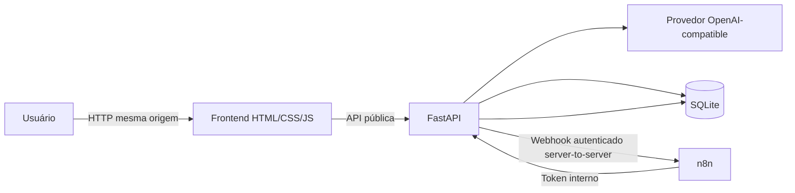

# Arquitetura do AtendeAI

## Componentes

O backend valida todas as entradas e saídas, aplica as regras de confiança e revisão humana, persiste os atendimentos e fornece os dados consumidos pela interface. O frontend não acessa o provedor de IA, o banco ou o webhook do n8n.

## Fluxo de criação

1. `POST /api/v1/attendances` grava o atendimento em estado `processing`.
2. O serviço de IA carrega `prompts/message_classification.md`, chama o endpoint Chat Completions configurado e valida a saída pelo schema Pydantic.
3. A classificação é salva. Confiança abaixo de `AI_CONFIDENCE_THRESHOLD` (padrão 0.70) ou sinalização do modelo bloqueia automação e marca revisão humana.
4. Casos sem revisão ficam `classified` e podem ser enviados ao webhook n8n. Sem webhook configurado, permanecem classificados com encaminhamento `pending`.
5. O n8n valida o payload, seleciona um dos quatro departamentos e registra o resultado no endpoint interno autenticado. A integração demonstra o destino sem presumir serviços externos de atendimento.
6. A API mantém o estado de encaminhamento separado da classificação; falhas podem ser consultadas e retentadas.

## Estados

- Atendimento: `received`, `processing`, `classification_failed`, `classified`, `pending_review`, `routing`, `routed`, `routing_failed`.
- Encaminhamento: `held`, `pending`, `in_progress`, `completed`, `failed`.

`Routing.idempotency_key` é estável por atendimento e há um registro de encaminhamento único por atendimento; callbacks repetidos após conclusão não criam um segundo encaminhamento.

## Contratos públicos

- `GET /health` — estado básico da API.
- `GET /api/v1/services/health` — configuração dos serviços; `configured` não significa que a conectividade externa foi testada.
- `POST /api/v1/attendances` — criar e classificar (`customer_name` e `customer_email` opcionais; mensagem até 10.000 caracteres).
- `GET /api/v1/attendances` — paginação, busca, filtros `category`, `department`, `priority`, `sentiment`, `status` e `requires_human_review`, ordenação por data.
- `GET /api/v1/attendances/{id}` — detalhe incluindo mensagem original.
- `GET /api/v1/classifications` — consulta paginada de classificações.
- `POST /api/v1/attendances/{id}/dispatch` — retentativa quando elegível.
- `GET /api/v1/analytics/overview`, `/distribution` e `/timeline?days=14` — métricas calculadas sobre SQLite.
- `POST /api/v1/internal/attendances/{id}/route` — callback exclusivo do n8n; exige `Authorization: Bearer <INTERNAL_API_TOKEN>`.

## Configuração externa

As configurações são lidas por `app/core/config.py`. `AI_BASE_URL` é a raiz do endpoint OpenAI-compatible e o serviço acrescenta `/chat/completions`. O workflow exportado tem credenciais vazias/placeholders; após importar, configure:

1. Credencial de Header Auth do Webhook com o nome `X-AtendeAI-Token` e o mesmo valor de `N8N_API_TOKEN`.
2. Credencial Header Auth do HTTP Request para o backend com nome `Authorization` e valor `Bearer <INTERNAL_API_TOKEN>`.
3. Ative o workflow e confira o caminho de produção `/webhook/atendeai/route`.
4. Para Compose, a URL interna do node é `http://api:8000`. Em execução fora dessa rede, altere a URL no node para o endereço alcançável pelo n8n.

Não publique credenciais exportadas, `.env` ou capturas que revelem segredos.
